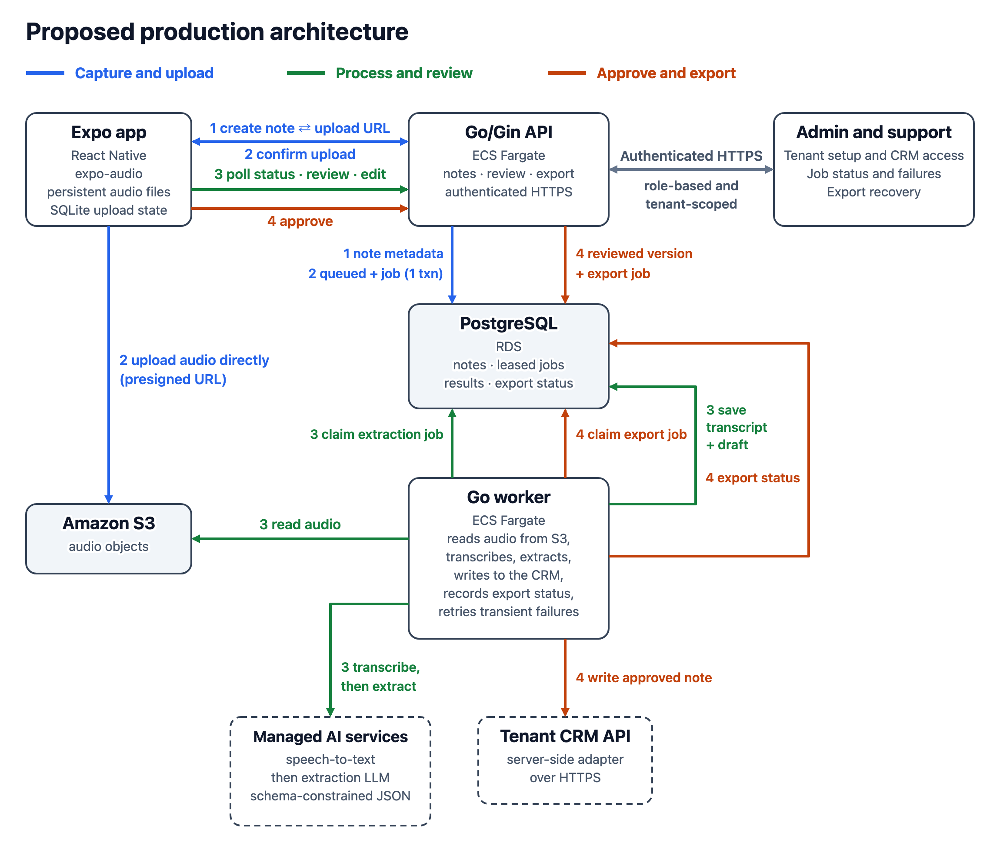

# Architecture Decision Record (ADR 001): Mobile, Backend, Infrastructure and AI

Proposed · November 2026

## Context

Assumed scenario. A field sales rep needs to capture a customer visit while offline, review the generated follow-up and sync the approved result to the CRM. Processing should continue after the rep leaves the app. Scale, languages and the number of tenants are not specified, so the choices below assume a small multi-tenant pilot and should be revisited once those are known.

## Building blocks

| Component | Technology | Why |
| :---- | :---- | :---- |
| Mobile | React Native, Expo, TypeScript, expo-audio, persistent app files and SQLite | Share one iOS and Android codebase, chosen over separate native apps because a small team can ship both platforms together; the cost is less direct control of native audio. Save audio and upload state locally so a rep can record offline and retry when connectivity returns. Test permissions and recording interruptions on both platforms. |
| Backend | Go/Gin modular monolith, HTTP API and worker | Go gives small container images and simple concurrency for the worker. Keep note, review and export logic in one codebase, chosen over microservices, which would add deployment and coordination cost before the service boundaries are known. Run the API and worker as separate processes so request traffic and audio processing can scale independently. |
| Infrastructure | AWS ECS Fargate, RDS for PostgreSQL, S3 | Run the API and worker on Fargate, chosen over EKS (cluster operations for two services) and Lambda (a poorer fit for leased background jobs). Store note, review and export state in PostgreSQL and audio in S3. Store extraction and export jobs in PostgreSQL so processing can continue after the app closes. |
| Identity | Managed OpenID Connect identity provider, such as Amazon Cognito or Auth0 | Reps, tenant admins and support staff sign in with the provider, which issues short-lived tokens carrying the tenant and role. The API validates every token and applies the tenant to each query. Chosen over building authentication in the API because credential storage, password reset and MFA stay out of the codebase; the cost is a vendor dependency and per-user pricing. |
| AI | Managed speech-to-text and an LLM with schema-constrained output | Keep a transcript to distinguish recognition errors from extraction errors. Two calls add latency and cost. Candidates are OpenAI, Deepgram or AssemblyAI for speech-to-text and OpenAI, Anthropic or Google for the LLM. Choose by measured extraction quality, latency and cost on the evals in Next steps, and keep each provider behind an interface so it can be swapped. Validate the output in Go, measure extraction quality on representative notes and let the rep review it before export. |
| Integrations | Server-side CRM adapters over HTTPS | Translate the approved note into each CRM's API format and track export status separately. Retry failed writes without rerunning audio processing. |

## Product data flow

*Proposed production architecture (click for full size). Blue: capture and upload, steps 1 and 2. Green: process and review, step 3. Orange: approve and export, step 4. Gray: admin and support access, described under Production operations. The numbers on the arrows match the steps below. "1 txn" means one database transaction. The API's check of the uploaded S3 object in step 2 and the identity provider are not drawn.*

1. **Capture offline.** The app saves the audio to a persistent app directory and a pending note with a client-generated ID to SQLite. When the app next runs with connectivity, it creates or retrieves that note over authenticated HTTPS and gets a short-lived, note-specific S3 upload URL. The same ID lets the app retry safely or request a fresh URL.
2. **Upload and queue.** The app uploads directly to S3 and confirms completion over HTTPS. The API verifies the object, sets the note to queued and inserts an extraction job in one PostgreSQL transaction. A uniqueness constraint prevents duplicate jobs on repeated confirmation. After this commit, processing can continue with the app closed. Before it, the app shows **Saved on this device** or **Uploading**. After it, the app shows **Processing**.
3. **Process and review.** The worker claims the job with a time-limited lease in a short transaction, then reads the audio from S3, calls speech-to-text and passes the transcript to the extraction LLM. It validates the result in Go and saves the transcript and draft in PostgreSQL. The app polls the API and lets the rep review and edit the draft.
4. **Approve and export.** Approval saves the exact reviewed version and inserts a separate export job in one transaction. The worker sends that version to the tenant's CRM and records export status. Failed exports can be retried independently of AI processing.

**Proposed production API.** JSON over authenticated HTTPS, with every call scoped to the caller's tenant:

- `PUT /notes/{id}` creates the note from the client-generated ID, or returns it if it already exists, so a retry is safe (step 1).
- `POST /notes/{id}/upload-url` returns a short-lived presigned S3 URL, or a fresh one (step 1).
- `POST /notes/{id}/confirm-upload` makes the API verify the object and queue extraction (step 2).
- `GET /notes/{id}` returns the status (awaiting upload, queued, processing, ready, exported or failed) and, once ready, the draft (step 3). The app polls it.
- `POST /notes/{id}/approve` saves the reviewed version and queues the export (step 4).

Admin and support actions use separate endpoints with role checks. The demo's single `POST /notes` collapses steps 1 to 3 into one synchronous call.

## Queue choice

Start with a PostgreSQL job table. The API can commit note state and job creation atomically, and the API and worker already run as separate processes. Revisit SQS if polling or job claims measurably affect API database performance, or if queue operations need isolation from PostgreSQL. With SQS, publish jobs through a transactional outbox and keep job handling safe under duplicate delivery.

## Failure handling and privacy

An expired lease allows another worker to reclaim the job. Only the current lease holder can commit results. Reclaiming a job can repeat an AI call. Bound retries and surface terminal failures.

Use a stable CRM idempotency key or external-ID upsert where supported. After a timeout with an unknown outcome, check the CRM by external ID before retrying if lookup is available. If the CRM provides neither a safe retry nor a way to reconcile the write, mark the outcome as uncertain for review.

Scope notes and CRM credentials by tenant, and keep provider keys and CRM credentials in a secrets manager. Apply audio retention and deletion policies and exclude note content from logs. Customer audio and transcripts go to third-party AI providers, so settle their retention and data-processing terms before using real customer data. Trace the upload, AI and export stages, and measure stage latency and failure rates before setting service targets.

## Production operations

Start with basic tools for tenant admins and support staff. Build a dedicated back-office app when the volume of onboarding and support work warrants it.

- **Tenant setup.** Tenant admins invite reps, manage access, and connect, test or revoke their tenant's CRM credentials.
- **Support and recovery.** Authorized support staff can see the note status, failed stage, attempt count and last error within the tenant. Keep audio and note content out of the default view. Support can retry a failed export independently of extraction. Reconcile an uncertain CRM write before allowing a retry.
- **Privacy and audit.** Set retention periods for audio and transcripts and provide a deletion workflow. Audit access changes, CRM credential changes and manual retries.
- **Monitoring and cost.** Track the oldest queued job, failures by stage, CRM authorization errors and AI usage by tenant. Alert on stalled jobs and spend above the configured threshold.

Launch check: after a rep approves a note and the CRM entry is missing, support should be able to tell whether the export is queued, the CRM connection needs renewal, or a timed-out write may already have succeeded. Support should be able to recover the export without listening to the recording or creating a duplicate.

## Demo

Demo flow · Record a short sales note in a single-screen Expo app, then upload it to a local Go/Gin service using multipart `POST /notes`. The service sends the audio directly to OpenAI `gpt-audio-1.5`, validates the returned JSON in Go and creates a child page under a private demo page using the Notion API. The app shows the summary and export result after Notion confirms the write.

The README covers setup (credentials, running the backend, and reaching it from a phone on the same Wi-Fi network), walks through the bundled sample with curl, then covers recording and uploading from an iPhone.

- **Notion export.** The demo writes a child page to show a complete integration.
- **One audio-native call.** The demo uses gpt-audio-1.5 to extract the note directly from audio. The proposed production flow saves a transcript for review and debugging.
- **Validation in Go.** Check the model's response before writing to Notion.
- **Synchronous endpoint.** Keep the demo setup to one Go service. The response includes the result after Notion confirms the write.

| Area | Demo | Production design above |
| :---- | :---- | :---- |
| AI | One audio-native call, no transcript | Speech-to-text, then a schema-constrained LLM, with the transcript kept |
| Upload and processing | Synchronous `POST /notes`, request held open | Presigned S3 upload, PostgreSQL jobs and a separate worker |
| Review | Result written to Notion immediately | Rep edits and approves before export |
| Export | One Notion page, no retry | CRM adapters with idempotent, retried writes and separate export status |
| Access | None, trusted network | Authenticated HTTPS, tenant-scoped data and credentials |
| Mobile | iOS only, WAV | Offline capture, upload recovery, iOS and Android |

## Next steps

The [roadmap](NEXT_STEPS.md) has the detail and the order. In short:

1. **Measure extraction quality.** Build a labeled audio set and score summary faithfulness, action-item precision and recall, and schema failures on every prompt or model change. Compare the demo's audio-native call with speech-to-text plus extraction on the same recordings.
2. **Trace and observe.** Add Langfuse tracing if it meets data-handling requirements, with raw audio, transcripts and note content excluded by default, plus stage latency, failure rates and cost per note.
3. **Harden the demo path.** Retry once on a 429 or 5xx and on invalid model output, add an idempotency key so a retried upload cannot create a second Notion page, add request IDs and an upload concurrency limit, and require authentication.
4. **Build the production flow in order.** Resumable upload and durable processing, then rep review and approval, then the first CRM adapter.

Open question: how the rep learns that a draft is ready after leaving the app. A push notification is the likely answer; polling covers the open app.
