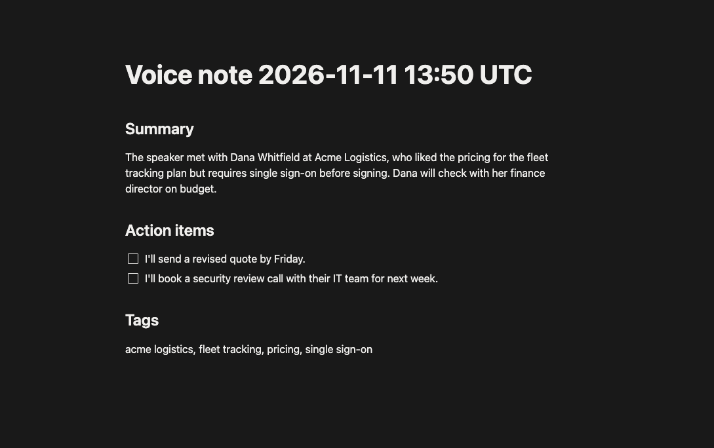

# Voice note to Notion

A sales rep records a voice note. A local Go/Gin service sends the audio straight to OpenAI (`gpt-audio-1.5`), extracts a **summary**, **action items** and **tags**, validates them, and creates a child page in Notion.

```
Expo app  →  Go/Gin  POST /notes  →  OpenAI gpt-audio-1.5  →  Notion page
```

Architecture and the production design, with a diagram: [ADR_001_Architecture.md](./ADR_001_Architecture.md). This repo implements its **Demo** section.

```
backend/                  Go + Gin service: POST /notes        (the part to run first)
mobile/                   Expo screen: Record, Stop, Upload    (optional demo on top)
samples/                  sample-note.wav (18 s) and its script (for the curl example)
docs/                     architecture diagram, Notion export screenshot
ADR_001_Architecture.md   architecture decision record
NEXT_STEPS.md             roadmap and further plans
```

## Start here

Run the local tests without credentials. The live demo requires OpenAI and Notion credentials.

1. **No credentials:** `cd backend && go test ./...` runs the whole backend suite against local test doubles (needs Go 1.25+).
2. **With credentials:** set up OpenAI and Notion under [Backend](#backend), then run the bundled sample with the curl command in [Try it with curl](#try-it-with-curl).

## Prerequisites

- **Go 1.25+**
- **OpenAI API key** with access to `gpt-audio-1.5`
- **Notion personal access token** and a parent page. The token acts as the user who created it, so that user needs access to the page. The page ID is the 32-character string at the end of the page URL.
- For the mobile demo: Node 22.18+ or 24 (Expo SDK 58 needs 22.13+, and `npm test` runs TypeScript directly, which needs 22.18+), and an **iPhone** with Expo Go on the same Wi-Fi as your computer (see [Mobile](#mobile-demo) for why iOS)

## Backend

```bash
cd backend
cp .env.example .env     # then fill in OPENAI_API_KEY, NOTION_API_KEY, NOTION_PARENT_PAGE_ID
go run .
```

The server refuses to start if a required variable is missing or `NOTION_PARENT_PAGE_ID` is not a 32-character page ID (a pasted page URL won't work). The error names the variable, never its value. It listens on `:8080`; change that with `PORT`. `GET /healthz` returns `ok`.

### Try it with curl

From the repo root, in a second terminal:

```bash
curl -i -F "audio=@samples/sample-note.wav" http://localhost:8080/notes
```

`-i` prints the response headers, so the status is visible next to the JSON. The sample is a synthetic voice (macOS `say`) reading the script in [`samples/sample-note.txt`](samples/sample-note.txt), so every name and detail in the output below comes from that script. Expected: a `201 Created` status line, then the JSON body. The body is shown formatted here (the server sends it on one line), and the wording varies from run to run:

```
HTTP/1.1 201 Created
Content-Type: application/json; charset=utf-8
Date: …
Content-Length: …

{
  "summary": "The speaker met with Dana Whitfield at Acme Logistics, who liked the pricing for the fleet tracking plan but requires single sign-on before signing. Dana will check with her finance director on budget.",
  "action_items": [
    "I'll send a revised quote by Friday.",
    "I'll book a security review call with their IT team for next week."
  ],
  "tags": ["acme logistics", "fleet tracking", "pricing", "single sign-on"],
  "notion_page_url": "https://app.notion.com/p/Voice-note-2026-11-11-13-50-UTC-…"
}
```

Open `notion_page_url` in a browser (signed in to Notion): a page titled `Voice note <UTC timestamp>` with Summary, Action items (unchecked checkboxes) and Tags, as in the screenshot below.



### What it accepts and how it fails

One multipart file in the `audio` field (a file in any other field is rejected), **WAV or MP3**, up to **10 MiB** (the whole request is capped at 11 MiB). The format is detected from the file's bytes, not its name or Content-Type. A WAV is checked chunk by chunk, so a truncated one, one with a header but no audio, or one whose header disagrees with its data chunk (for example a recording that was cut off before it was finalized) is rejected; so is an MP3 with no Layer III audio behind its tag.

| Status | `error.code` | Cause |
| --- | --- | --- |
| 400 | `missing_audio`, `invalid_upload` | no file in `audio`, several files, or not multipart |
| 413 | `too_large` | file or request over the limit |
| 415 | `unsupported_audio` | not WAV/MP3, or truncated or empty (for example an `.m4a` renamed to `.wav`) |
| 502 | `model_output_invalid` | the model's JSON failed validation; **nothing is written to Notion** |
| 502 | `openai_failed`, `notion_failed` | upstream rejected or was unreachable |
| 504 | `openai_timeout`, `notion_timeout` | upstream deadline (OpenAI 60 s, Notion 15 s) |
| 500 | `internal_error` | an unexpected server error (a panic is caught and logged without its content) |

Errors look like `{"error": {"code": "...", "message": "..."}}`.

The format check is a sanity check, not a decoder: a file that passes it but cannot be decoded is rejected by OpenAI and shows up as `502 openai_failed`.

Credentials, audio and note content are kept out of logs by design. A request logs only method, path, status and duration, and an upstream failure logs only its HTTP status and an error code from a fixed list of known OpenAI and Notion codes. The response body is controlled by the provider (or by a proxy set as the base URL), so any other value is logged as `unrecognized`. If a call never gets an answer (for example a connection error), the log holds the network error text, which contains the URL but no content or credentials.

### Tests

```bash
cd backend && go test ./...
```

Tests run the real OpenAI and Notion clients against local `httptest` servers, so they check the exact request each API receives. They cover validation, size limits, timeouts, client disconnects and log hygiene. They need no credentials.

To test how the mobile app validates the server response, run `cd mobile && npm install && npm test`.

## Mobile demo

```bash
cd mobile
npm install
npx expo start
```

Scan the QR code with the iPhone camera to open the app in Expo Go. There is nothing to configure: the app takes the address of the computer running Expo and sends uploads to port 8080 on it, so it follows your Wi-Fi address. If your address changes, restart `npx expo start` and scan the new QR code. The backend URL is shown in the field at the top of the app and can be edited there.

To point the app somewhere else, such as a backend on another machine or port, set `EXPO_PUBLIC_API_URL=http://<host>:<port>` in `mobile/.env` (see `mobile/.env.example`) and restart Expo. In Expo's tunnel mode its address can't reach your computer, so the app falls back to `http://localhost:8080`; edit the field or set the variable.

Record, Stop, then Upload. The app shows the summary, action items, tags and an **Open in Notion** button.

<details>
<summary>Expo Go says "You need to be signed in to Expo Go and Expo CLI"?</summary>

Seen on SDK 58 when opening the project from Expo Go's list. Sign in inside Expo Go, and on your computer run `npx expo login --browser` (the browser flow offers Google sign-in; plain `npx expo login` falls back to a password prompt in a non-interactive shell). Opening the project by URL in the iOS Simulator worked without signing in.

</details>

**iOS only.** The backend accepts WAV and MP3. On iOS the app records 16 kHz mono 16-bit WAV. `expo-audio` cannot record WAV or MP3 on Android, which produces `.m4a`. After you press Stop the app reads the file header and shows what was actually recorded (for example `Recorded WAV · 111 KB`). If the format is unsupported, Upload stays disabled and says so. A 4-minute recording limit keeps files under the 10 MiB cap.

In the iOS Simulator, `npx expo start --ios` works the same way.

## Known limits of the demo

- **No authentication.** Anyone on the same Wi-Fi who can reach port 8080 can create Notion pages and spend OpenAI credits. Use a network you trust. The ADR's production design adds authenticated HTTPS.
- A failed Notion write after a successful extraction is not retried, so the note is lost until you upload again. Retries without re-running the model are in the ADR's production design.
- Audio is held in memory for the request and never written to disk.
- The OpenAI request sets `store: false`, so the completion is not saved for later retrieval in OpenAI's dashboard. Check OpenAI's data-retention terms for your account before using real customer audio.
- The model is asked for JSON in the prompt and validated strictly in Go (no `response_format`: the model page lists only streaming and function calling as supported features).
- **Demo vs. ADR:** the demo makes one audio-native call and keeps no transcript. The ADR's production design uses speech-to-text and then a schema-constrained LLM, which keeps a transcript to tell recognition errors from extraction errors, at the cost of a second call.

## Next steps

See the [roadmap](NEXT_STEPS.md) for extraction evals, demo hardening and the production rollout.

## AI assistance

I used AI coding tools to help implement, review, and document this demo. I reviewed the architecture and implementation choices. Verification included local tests and a live Notion export of the bundled sample.
