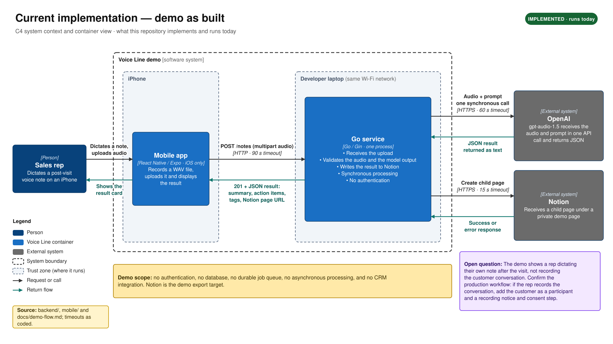
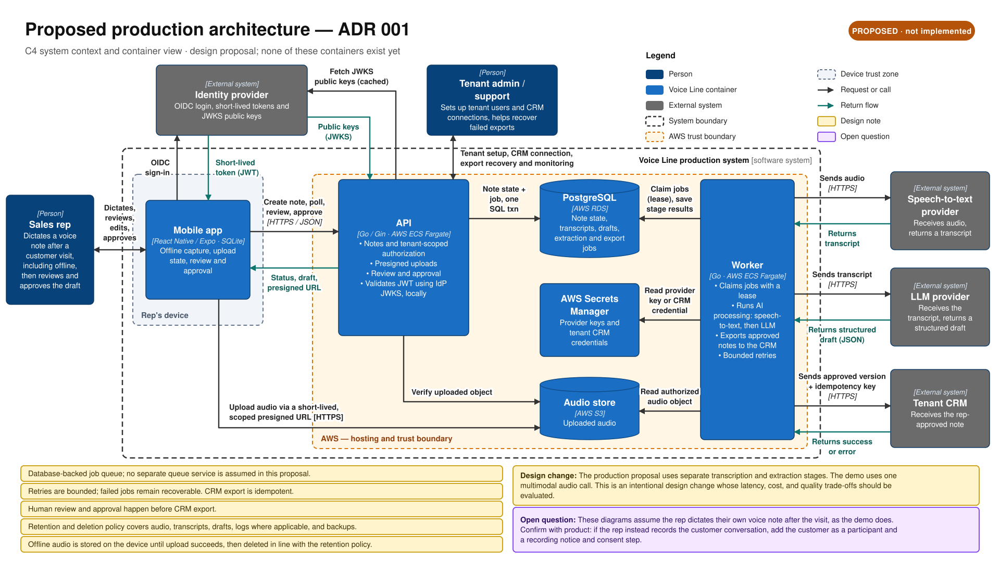

# C4 diagrams: Voice Line

Two separate C4-style diagrams (system context and container level, no components or classes). Read the second next to [ADR_001_Architecture.md](../ADR_001_Architecture.md).

| Diagram | Status | Editable source | Image |
| --- | --- | --- | --- |
| Current implementation: demo as built | Implemented, runs today | [c4-current-demo.drawio](c4-current-demo.drawio) | [c4-current-demo.svg](c4-current-demo.svg) |
| Proposed production architecture: ADR 001 | Proposed, none of it is built | [c4-proposed-production.drawio](c4-proposed-production.drawio) | [c4-proposed-production.svg](c4-proposed-production.svg) |

To change a diagram, open the `.drawio` file in [diagrams.net](https://app.diagrams.net) (or the desktop app). Connectors are attached to the boxes, so they follow when you move one. Then use File, Export as, SVG to refresh the `.svg` that this page and other docs show.

## Current implementation: demo as built

## Proposed production architecture: ADR 001

## How to read them

- **Colours.** People are dark blue, Voice Line containers are blue, external systems are grey. Dashed outlines are the system boundary and trust zones: the iPhone and laptop in the demo; the rep's device and the AWS account in production.
- **Arrows** point in the direction of the call or data sent. Dark arrows are requests, green arrows are return flows from the called system. The sales rep and admin links, which are two-way conversations, use one double-headed arrow.
- **Current versus proposed.** The demo diagram holds only what the repo implements. Everything on the production diagram is a proposal, and it is badged as such. The demo's one multimodal audio call becomes separate transcription and extraction stages in production; that is a deliberate design change to evaluate, not a settled one.

## Jobs and transactions in production

The API writes to PostgreSQL in two separate transactions, and each creates a different job (ADR 001, steps 2 and 4):

1. **Upload confirmed.** The API verifies the audio object, sets the note to queued and creates the **extraction job**.
2. **Rep approves.** The API saves the exact version the rep approved and creates the **export job**.

The worker claims either kind of job with a lease. No export job exists until the rep approves, so the worker can only export an approved version, never a draft.

## Where the diagrams go beyond the ADR

Three flows were added because ADR 001 describes them; remove them if you want a leaner diagram:

- **API to the audio store, "Verify uploaded object".** The API verifies the S3 object on upload confirmation (ADR 001, step 2).
- **API back to the app, "Status, draft, presigned URL".** The app polls for status and the draft, and gets the presigned upload URL from the API.
- **CRM back to the worker, "Returns success or error".** The worker records the export status.

Two statements on the production diagram are not in ADR 001 yet and should be added there if they stand:

- **"Validates JWT using IdP JWKS, locally".** ADR 001 says the API validates every token but not how. The diagram shows the API fetching and caching the identity provider's public keys (JWKS) and checking the token signature itself, so no identity-provider call happens per request. It also calls the tokens JWTs.
- **"Offline audio is stored on the device until upload succeeds, then deleted in line with the retention policy".** ADR 001 saves offline audio to a persistent app directory and requires retention and deletion policies, but does not say when the on-device copy is deleted.

## What the sales rep does

Both diagrams show the rep **dictating their own voice note after a customer visit**, not recording the conversation with the customer. The demo does exactly this: [demo-flow.md](demo-flow.md) says the rep "records a voice note after a customer visit", and the bundled sample note starts "Quick note after my visit with Dana". ADR 001 only says the rep needs to "capture a customer visit", so for production this is an assumption, and both diagrams carry it as an open question.

If the product turns out to record the conversation itself, the diagrams need a customer participant and a step that informs the customer and gets their consent before recording, and the privacy notes need revisiting.

## Other sources

The demo diagram's "Developer laptop, same Wi-Fi network" zone comes from the README and [demo-flow.md](demo-flow.md), which run the service locally and reach it from a phone on the same network.
